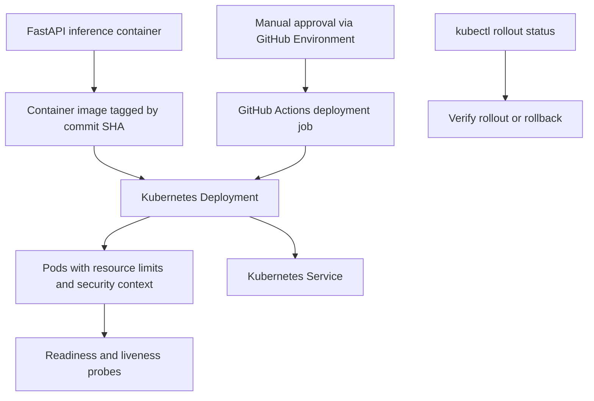

# Customer Churn MLOps — FastAPI, Docker & CI/CD

[](https://github.com/erfantk25-lab/fastapi-docker-ml-serving/actions/workflows/ci.yml) [View all workflow runs](https://github.com/erfantk25-lab/fastapi-docker-ml-serving/actions)

<div align="center">


   

</div>


An educational MLOps project for customer-churn prediction, combining data validation, model training and evaluation, model lineage, container packaging, and a FastAPI inference service.

This repository is part of my personal portfolio. It documents two clearly separated types of work:

- **Collaborative work:** the customer-churn pipeline, developed with a project team.
- **My individual work:** a Kubernetes deployment and continuous-delivery mini-project, described in its own section below.

The collaborative repository is maintained separately by the team: [LeoLindqvist123/ci-cd-pipeline](https://github.com/LeoLindqvist123/ci-cd-pipeline). This README update changes **only this repository**.

> Saldes Mobil AB and the customer data are fictional and used for an educational case study.

## Project overview

The pipeline is designed to ensure that incoming data is validated and a candidate model passes evaluation checks before it is packaged for inference.

| Area | Technologies / approach |
|---|---|
| API | FastAPI |
| Machine learning | Python, scikit-learn |
| Data validation | Pandera |
| Experiment tracking | MLflow |
| Testing | pytest, API tests, container smoke tests |
| Packaging | Docker, multi-stage builds, Buildx caching |
| CI/CD | GitHub Actions |
| Container registry | GitHub Container Registry (GHCR) |
| Individual deployment mini-project | Kubernetes, kind |

## High-level workflow

<div align="center">

</div>

GitHub Actions coordinates the documented CI workflow. A candidate that fails the quality gate is not passed to the packaging stage. The separate Kubernetes learning exercise is shown in its own lane and explained below.

## API

The FastAPI service exposes:

| Method | Endpoint | Purpose |
|---|---|---|
| GET | `/health` | Check API/model availability |
| POST | `/predict` | Return a churn prediction and probability |

FastAPI also provides interactive API documentation at `/docs` when the service is running.

## Data quality and model evaluation

The project uses Pandera schema validation to check incoming customer data before model training. The documented CI checks include known-good and known-bad deliveries to verify that invalid data is rejected.

The model workflow evaluates ROC AUC and accuracy, and reports precision, recall, and F1-score across classification thresholds. A seed-variance analysis was used to understand how much ROC AUC varies across different train/test splits.

The documented quality policy uses:

- An absolute ROC AUC threshold of **0.74**.
- A separate regression gate allowing a maximum ROC AUC decrease of **0.020** against the approved baseline.

These values are project-specific configuration decisions, not universal ML standards. They should be reviewed when the data, features, or model changes.

## Model tracking and lineage

The documented pipeline records model metadata to improve traceability, including:

- Git commit identifier.
- Dataset filename and SHA-256 hash.
- Evaluation metrics.
- MLflow run identifier when tracking is enabled.

The workflow also uses artifact integrity checks so that changes to a model file can be detected when its trusted checksum is available.

## Docker and CI/CD

The collaborative pipeline documents a delivery flow that:

1. Runs tests and data validation.
2. Trains and evaluates a candidate model.
3. Applies model quality and regression gates.
4. Builds a Docker image.
5. Starts the container and performs smoke tests against the API.
6. Publishes a verified image to GHCR from the configured main-branch workflow.

The Docker setup includes a multi-stage build, a non-root runtime user, a health check, and Buildx layer caching.

The team reported approximately **39% smaller uncompressed Docker images** and **30% faster measured builds** after optimization. These are collaborative project results, not individual performance claims.

## My individual work: Kubernetes deployment mini-project

The following deployment flow summarises the individual Kubernetes exercise (not the shared team pipeline):



Example commands used to apply and inspect the manifests in the educational cluster:

```bash
kubectl apply -f k8s/ -n erfan-tahmasbikondroodi
kubectl rollout status deployment/saldes-deployment -n erfan-tahmasbikondroodi --timeout=180s
kubectl get pods,svc,ingress -n erfan-tahmasbikondroodi
# If a rollout must be reverted:
kubectl rollout undo deployment/saldes-deployment -n erfan-tahmasbikondroodi
```

Separately from the collaborative pipeline, I completed an **individual Kubernetes deployment and continuous-delivery mini-project** for the inference service.

The individual work documented in this repository includes:

- Kubernetes Deployment and Service manifests.
- Container image references pinned to a full commit SHA.
- CPU and memory requests and limits.
- Readiness and liveness probes using the API health endpoint.
- A restricted security context, non-root execution, and dropped Linux capabilities.
- Multi-architecture container images for `linux/amd64` and `linux/arm64`.
- A RollingUpdate strategy with two replicas, zero unavailable replicas, and one surge pod.
- A GitHub Actions deployment job restricted to pushes to `main` and protected by manual approval through a GitHub Environment.
- Rollout verification and a documented rollback using `kubectl rollout undo`.

The deployment work was tested in local `kind` and the course cluster, as documented in the project. The monitoring and drift-response material describes an operational plan; it should not be read as a claim that a complete production monitoring service is running.

## What I learned

- Designing data and model quality gates before release.
- Connecting model artifacts to source-code and dataset versions.
- Separating model evaluation, image packaging, and deployment.
- Building and smoke-testing a containerized inference API.
- Applying Kubernetes health probes, resource limits, immutable image references, and rolling updates.
- Clearly distinguishing my individual implementation from team-level outcomes.

## Related links

- [My GitHub profile](https://github.com/erfantk25-lab)
- [My portfolio](https://erfantk25-lab.github.io/)
- [Collaborative CI/CD repository](https://github.com/LeoLindqvist123/ci-cd-pipeline)

---

*Educational portfolio project. Collaborative pipeline work and my individual Kubernetes mini-project are intentionally presented as separate contributions.*
