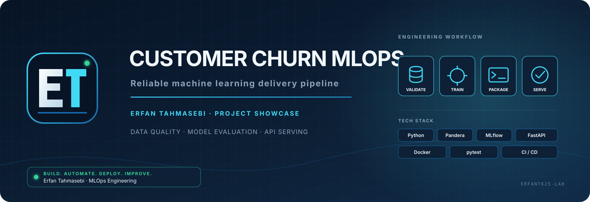
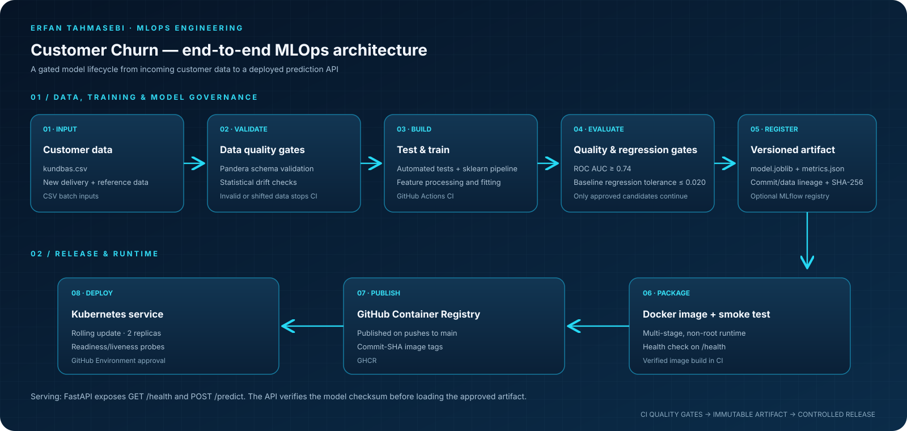

<div align="center">



</div>

# Customer Churn MLOps — FastAPI, Docker & Kubernetes

## 🧰 Technology Stack

<div align="center">

  <a href="https://www.python.org/" title="Python"></a>
  <a href="https://pandera.readthedocs.io/" title="Pandera"></a>
  <a href="https://scikit-learn.org/" title="scikit-learn"></a>
  <a href="https://mlflow.org/" title="MLflow"></a>
  <a href="https://fastapi.tiangolo.com/" title="FastAPI"></a>
  <a href="https://www.docker.com/" title="Docker"></a>
  <a href="https://github.com/features/actions" title="GitHub Actions"></a>
  <a href="https://kubernetes.io/" title="Kubernetes"></a>

</div>

An educational MLOps project for predicting [customer churn for Saldes Mobil AB](https://github.com/saldes-education/saldes-mobil-churn). It combines data validation, model training and evaluation, model artifact lineage, a FastAPI inference service, Docker packaging, automated CI/CD, and an individually documented Kubernetes deployment mini-project. The repository includes reproducible local commands and automated checks so the pipeline can be inspected without deploying it to a cluster.

## 🏗️ Architecture

<div align="center">

</div>

The diagram shows the full model lifecycle: incoming customer data passes schema and drift validation before training. A candidate must pass the ROC AUC and regression gates before its model artifact is versioned and packaged. CI verifies the Docker image, publishes it to GHCR, and deploys the approved image to Kubernetes. The FastAPI service loads the checksum-verified model for inference.


## 🚀 Quick Start

**Prerequisites:** Python 3.11–3.13 and [uv](https://docs.astral.sh/uv/getting-started/installation/).

Clone this repository (not the original team repository), then install the locked dependencies:

```bash
git clone https://github.com/erfantk25-lab/fastapi-docker-ml-serving.git
cd fastapi-docker-ml-serving
uv sync --all-extras
```

Run the same code-quality and test checks used in CI:

```bash
uv run ruff check .
uv run pytest
```

Train the model and generate its local artifacts:

```bash
uv run python -m churn.model
```

The training step creates the model and metrics under `outputs/`. Start the API after training using the command in the [FastAPI section](#fastapi).
## FastAPI

The API predicts customer churn using the trained model.

Start the API:

```bash
uv run uvicorn churn.api:app --reload
```

Open [http://127.0.0.1:8000/docs](http://127.0.0.1:8000/docs) to test the endpoints.

- `GET /health` — checks model availability.
- `POST /predict` — returns a churn prediction and probability.
- `GET /demo` — serves an interactive browser demo with fictional customer inputs.

### Interactive browser demo

After training the model and starting the API, open [http://127.0.0.1:8000/demo](http://127.0.0.1:8000/demo). The page checks model availability, submits the form to `POST /predict`, and displays the predicted class and probability. It is also included in the Docker image because the runtime copies the complete `src/` directory.

The prefilled values are illustrative. Use fictional data only; this is an educational model demonstration, not a production decision tool.

### Demo screenshots

The following screenshots show the existing FastAPI request/response flow:

<div align="center">

**Request**


**Response**


</div>

To capture the interactive browser UI and create a short before/after prediction GIF from a **running API with a trained model**, follow the [demo capture instructions](#capture-real-demo-screenshots-and-gif). The generated files are deliberately not committed as pre-made results: they must come from a real successful prediction.

#### Capture real demo screenshots and GIF

```bash
uv run python -m churn.model
uv run uvicorn churn.api:app --reload
# In a second terminal:
python -m pip install playwright pillow
python -m playwright install chromium
python scripts/capture_demo.py
```

The script writes `docs/demo_input.png`, `docs/demo_prediction.png` and `docs/demo_prediction.gif`. It stops if the API/model is unavailable or the live prediction fails.

Run API tests:

```bash
uv run pytest tests/test_api.py
```

## ✅ Data Validation

The data is validated against a Pandera schema (`validation/schema.py`) in CI. To run it locally:

```bash
uv run python validation/schema.py [path/to/file.csv]
```
If no file is given, `data/kundbas.csv` is used. For example, to validate a new delivery:

```bash
uv run python validation/schema.py data/kundbas_ny_leverans.csv
```

If validation fails, the script lists errors per column and check with a few examples, and exits with code 1, which fails the CI pipeline.

In CI, the `validate` job checks both data files in parallel:

- `kundbas.csv` must **pass**.
- `kundbas_ny_leverans.csv` must **fail**. It is a known-bad delivery that proves the schema catches errors.
- `kundbas_drift_leverans.csv` must pass schema validation but fail the drift check.

The validation job verifies that valid data passes schema validation and known-invalid data is rejected. These checks run before model training.
The `train` job depends on both `test` and `validate` through
`needs: [test, validate]`. This ensures that model training only
starts when both jobs have succeeded.

## 📊 Model Performance

<div align="center">

| Metric | Result | Meaning |
|---|---:|---|
| **ROC AUC — seed 42 baseline** | **0.789** | Ranking quality on the held-out test split |
| 30-seed mean ROC AUC | 0.783 ± 0.020 | Mean and standard deviation across split seeds 0–29 |
| 30-seed observed range | 0.746–0.836 | Variation caused by different train/test splits |
| CI quality gate | ≥ 0.740 | Absolute minimum before artifact publication |
| Regression floor | ≥ 0.769 | Baseline 0.789 minus the allowed 0.020 drop |

</div>

The reference score is stored in `config/model_baseline.json`. The seed-variance experiment is documented in `analysis/seed_variance.py`; it shows why a fixed test split can move ROC AUC even when the model is unchanged.

**Other evaluation metrics:** training writes `accuracy` plus precision, recall and F1 at thresholds 0.3, 0.4, 0.5, 0.6 and 0.7 to `outputs/metrics.json`. These threshold-specific values are recalculated on each run, so they are intentionally not presented here as permanent benchmark numbers.

### Threshold and regression policy

A lower classification threshold generally increases recall and false positives; a higher threshold generally increases precision while potentially missing more churners. Review the generated threshold metrics before choosing an operating point. For rigorous threshold selection, tune on validation data and keep the test set for final evaluation.

CI first enforces **ROC AUC ≥ 0.740**, then checks the candidate against the approved seed-42 baseline (**0.789**, maximum regression **0.020**). Only a candidate passing both gates proceeds to versioning and packaging. The thresholds are project-specific, not universal model-quality standards.

## 📦 Model Versioning & Lineage

Every model that passes the CI quality gate is versioned as a traceable artifact linked to the exact code commit and dataset that produced it.

### How it works
1. **Metadata & Lineage Generation (`src/churn/model.py`):**
   When `uv run python -m churn.model` runs, it generates both the trained model (`outputs/model.joblib`) and a metadata file (`outputs/metrics.json`) containing:
   - **Evaluation metrics:** `roc_auc`, `accuracy`, and threshold-specific metrics (`precision`, `recall`, `f1`).
   - **Commit traceability:** `commit` (populated from `GITHUB_SHA` in GitHub Actions, or `"local"` when run locally).
   - **Data traceability:** `data_file` (`kundbas.csv`) and `data_sha256` (a 64-character SHA-256 hash of the dataset's exact contents).

2. **Gated Versioning in CI (`.github/workflows/ci.yml`):**
   - The `train` job uploads a temporary candidate artifact (`model-candidate-<sha>`, `retention-days: 1`).
   - The `evaluate` job downloads the candidate, writes the metrics and lineage table to the GitHub Actions **Job Summary**, and runs `uv run python -m churn.evaluate`.
   - **Only if the model passes the quality threshold** (`ROC AUC >= 0.74`) does CI publish the official versioned artifact `model-<sha>`.
   - The approved model is also registered in the MLflow Model Registry, see [Experiment Tracking & Model Registry](#-experiment-tracking--model-registry-mlflow).

3. **Automated Lineage Testing (`tests/test_model.py`):**
   The test `test_model_versioning_metadata` verifies that `model.joblib` and `metrics.json` are created with valid `commit`, `data_file`, `data_sha256`, and evaluation metric fields:

   ```bash
   uv run pytest tests/test_model.py
   ```

### Model Artifact Integrity

The pipeline verifies the integrity of the trained model using SHA-256 checksums.

After training, the pipeline saves the model as `outputs/model.joblib` and generates a corresponding `outputs/model.joblib.sha256` checksum file.

Before the model is used, the checksum is verified at the following stages:

- **Evaluation:** verifies the downloaded candidate model before evaluation.
- **Docker packaging:** verifies the approved model artifact before building the image.
- **Call-list generation:** verifies the model before scoring customers.
- **API startup:** verifies the model before loading it into the FastAPI service.

If the model is missing, its checksum is missing, or its contents no longer match the checksum, verification fails. The CI job stops, or the API rejects the model instead of loading it.

Automated tests cover valid artifacts, modified model files, missing files and API behaviour when integrity verification fails.

**Limitation:** This checksum mechanism detects changes when the saved checksum remains trustworthy. It does not independently authenticate the model and checksum if both are replaced.

## 🧪 Experiment Tracking & Model Registry (MLflow)

MLflow is optional; `outputs/metrics.json` and the evaluation gates remain the source of truth.

When `MLFLOW_TRACKING_URI` is set, `churn.model` logs parameters, evaluation metrics, dataset/commit lineage and the sklearn model to the `churn` experiment. After the quality gates pass, `churn.register` registers the model as `churn-model` and assigns the `champion` alias.

Run a local tracking server:

```bash
MLFLOW_TRACKING_URI=sqlite:///mlflow.db uv run python -m churn.model
MLFLOW_TRACKING_URI=sqlite:///mlflow.db uv run python -m churn.register
uv run mlflow ui --backend-store-uri sqlite:///mlflow.db
```

Open [http://127.0.0.1:5000](http://127.0.0.1:5000). CI also uploads the tracking database as a workflow artifact for inspection. Each CI run currently starts with a fresh SQLite database, so persistent cross-run history requires a shared tracking server.

```bash
uv run pytest tests/test_tracking.py tests/test_register.py
```


## 🐳 Docker Packaging, Smoke Test & GHCR

The approved churn model and FastAPI service are packaged into a Docker image, verified with an automated smoke test, and published to GitHub Container Registry (`ghcr.io`).

### Build and run locally
Make sure the model has been trained first (`uv run python -m churn.model`), then build and start the container:
```bash
docker build -t churn-api:local .
docker run -d --name churn-test-service -p 8000:8000 churn-api:local
```

### Run the container smoke test
The smoke test (`tests/smoke_test.py`) polls `GET /health` until the container is ready and verifies that `POST /predict` returns a valid prediction (`0` or `1`) and probability (`0.0–1.0`):
```bash
uv run python tests/smoke_test.py http://localhost:8000
docker rm -f churn-test-service
```

### CI/CD & GHCR Publishing
In `.github/workflows/ci.yml`, the `package` job runs after `evaluate`:
1. Downloads the approved `model-<sha>` artifact.
2. Builds the Docker image and runs `tests/smoke_test.py` against the live container.
3. On `push` events to `main`, pushes the verified image to `ghcr.io/erfantk25-lab/fastapi-docker-ml-serving/churn-api` tagged with both `<commit-sha>` and `latest`.

### 🚀 Docker Optimization & Resource Management

The image uses a multi-stage build, production-only dependencies, a non-root `appuser`, a native `/health` health check and GitHub Actions Buildx layer caching.

| Metric | Earlier build | Optimized build |
|---|---:|---:|
| Uncompressed image | ~620 MB | **~378 MB** |
| Build duration | 16 s | **11.3 s** |
| Change | — | **~39% smaller · ~30% faster** |

These are one-off measured build comparisons, not continuous performance guarantees.

## 🛡️ Statistical Data Drift & Safe Data Delivery (VG)

To protect the model from retraining on skewed or incomplete data deliveries that still pass static Pandera schema rules, `src/churn/drift.py` compares incoming deliveries against `data/kundbas.csv`:
- **Volume Sanity Check:** Fails if row count drops below 50% of the reference dataset.
- **Numeric Feature Drift (`MAX_MEAN_SHIFT_STD = 0.50`):** Fails if any raw numeric feature mean shifts by more than 0.50 standard deviations.
- **Unseen Categories:** Fails if new categories appear in `region` or `abonnemang`.
- **Target Rate Drift (`MAX_TARGET_DIFF = 0.15`):** Fails if the churn rate (`avslutat`) shifts by more than 15 percentage points.
- **CI & Local Usage:** Runs in the `validate` job before `train` on `data/kundbas.csv` (expected: pass) and `data/kundbas_drift_leverans.csv` (passes Pandera schema, expected to fail drift check via `uv run python -m churn.drift data/kundbas_drift_leverans.csv data/kundbas.csv`) and is tested via `uv run python -m pytest tests/test_data.py`.

## 📁 Project Structure

```text
ci-cd-pipeline/
├── .github/
│   ├── actions/
│   │   └── setup-project/
│   │       └── action.yml
│   └── workflows/
│       └── ci.yml
├── analysis/
│   └── seed_variance.py
├── config/
│   └── model_baseline.json
├── data/
│   ├── kundbas.csv
│   ├── kundbas_ny_leverans.csv
│   └── kundbas_drift_leverans.csv
├── validation/
│   └── schema.py
├── docs/
│   ├── fastapi_prediction_prompt.png
│   ├── fastapi_prediction_response.png
│   ├── mlflow_ci_run.png
│   └── mlflow_registry_champion.png
├── outputs/
│   ├── model.joblib
│   ├── metrics.json
│   ├── model.joblib.sha256
│   └── call_list.csv
├── src/
│   └── churn/
│         ├── __init__.py
│         ├── api.py
│         ├── artifact_integrity.py
│         ├── data.py
│         ├── drift.py
│         ├── evaluate.py
│         ├── model.py
│         ├── regression_gate.py
│         ├── register.py
│         ├── score.py
│         └── tracking.py
├── tests/
│   ├── smoke_test.py
│   ├── test_artifact_integrity.py
│   ├── test_api.py
│   ├── test_data.py
│   ├── test_features.py
│   ├── test_regression_gate.py
│   ├── test_model.py
│   ├── test_register.py
│   └── test_tracking.py
├── create_issues.py
├── issues_followup.json
├── issues.json
├── .dockerignore
├── .gitignore
├── Dockerfile
├── pyproject.toml
├── README.md
└── uv.lock
```

## 🛠️ Development Roadmap & Task Status

*(Team: Please update the status of your assigned tasks below when you merge your PR!)*

### 1. Infrastructure & Setup
- [x] Create project board and generate backlog issues
- [x] Migrate dependency management to `uv` and generate lockfile

### 2. CI/CD & Testing
- [x] Verify branch protection and required status checks
- [x] Set up CI pipeline for code quality (Linting/Formatting)
- [x] Create Pandera schema for data validation
- [x] Set up CI pipeline for Pandera data validation tests
- [x] Set up CI pipeline for model training and unit tests
- [X] Verify that invalid data blocks training in the actual pipeline

### 3. Machine Learning
- [X] Analyze model thresholds and document findings
- [ ] Refine feature engineering pipeline
- [X] Version approved model artifacts with commit and data metadata
- [X] Verify that failing model evaluation prevents publication
- [x] Track experiments and register approved models with MLflow (optional step)

### 4. Model Serving & FastAPI

- [X] Add FastAPI prediction endpoint (`POST /predict`)
- [X] Add health endpoint (`GET /health`)
- [X] Add automated API tests
- [X] Document how to run and test the API locally

### 5. Docker & Artifact Publishing

- [x] Create Dockerfile for the model-serving application
- [x] Build and run the Docker image
- [x] Add a container smoke test
- [x] Push verified images to GitHub Container Registry (GHCR)
- [x] Tag published images with the relevant commit SHA

### 6. Documentation & Final Verification

- [ ] Update README to reflect the completed pipeline
- [ ] Capture a successful end-to-end pipeline run
- [ ] Capture a run where invalid data stops validation
- [ ] Prepare final repository, commit and PR/review links for submission

## 👥 Collaborators

This project is collaboratively developed by:
* [Lilit Ajoyan](https://github.com/LAjoyan)
* [Erfan Tahmasebi](https://github.com/erfantk25-lab)
* [Leo Lindqvist Kröhnert](https://github.com/LeoLindqvist123)
* [Josefin Lesley](https://github.com/Josefin3647)

---

## Kubernetes Deployment & CD (Mini-Project)

The individual deployment mini-project documents deployment to local `kind` and the course cluster.

- **Immutable releases:** Kubernetes manifests pin images to the full commit SHA.
- **Multi-architecture:** CI builds `linux/amd64` and `linux/arm64` images with QEMU and Buildx.
- **Safe rollout:** two replicas use `RollingUpdate` with `maxUnavailable: 0` and `maxSurge: 1`; readiness/liveness probes call `/health`.
- **Resource and security controls:** namespace-compatible CPU/memory limits and a restricted, non-root container security context.
- **Deployment gate:** the CD job runs on pushes to `main`, uses the `production` GitHub Environment for approval, and verifies rollout completion.
- **Operations plan:** validate schema and drift before training; gate releases on ROC AUC and regression checks; roll back unhealthy releases with `kubectl rollout undo`.

The course-cluster configuration and namespace are specific to the original learning environment; adapt them before deploying elsewhere.

### AI Usage Disclosure
AI tools were used as a sounding board to structure Kubernetes manifests (`deployment.yaml`, `service.yaml`) within `student-quota`, diagnose the `aarch64` vs `x86_64` architecture mismatch (`exec format error`) and configure multi-arch Buildx builds in GitHub Actions, and refine the documentation. All configurations, rollouts, and rollbacks were tested and verified in both `kind` and the course cluster.
