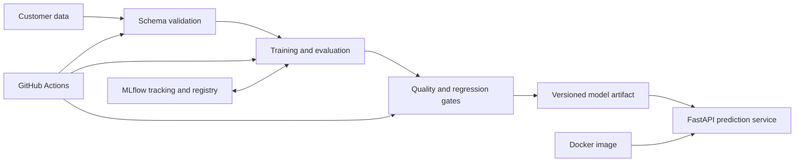

# Architecture

This diagram summarizes the workflow described in the repository README. Verify each component against the current implementation before extending the system.

## Main boundaries

- **Data and validation:** schema checks reject malformed deliveries before model training.
- **Training and evaluation:** the model workflow produces metrics and traceability metadata.
- **Release gate:** absolute quality and baseline-regression checks decide whether an artifact can be published.
- **Serving:** FastAPI exposes health and prediction endpoints.
- **Packaging and automation:** Docker and GitHub Actions support repeatable build and delivery.

## Operational questions to document as the implementation evolves

- Which exact workflow publishes the serving image?
- How are model and API compatibility checked together?
- Where are secrets configured, and how are they kept out of Git?
- What rollback procedure is used for a bad model or image?
